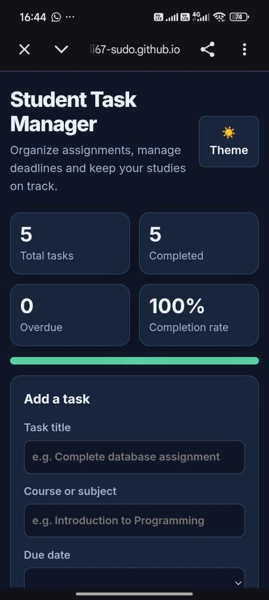
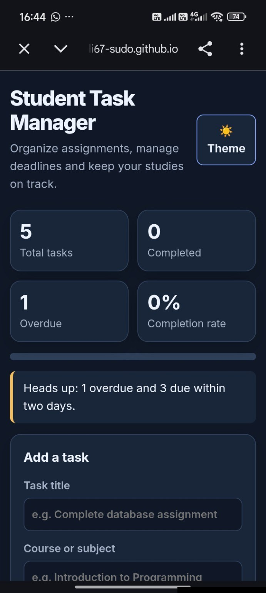
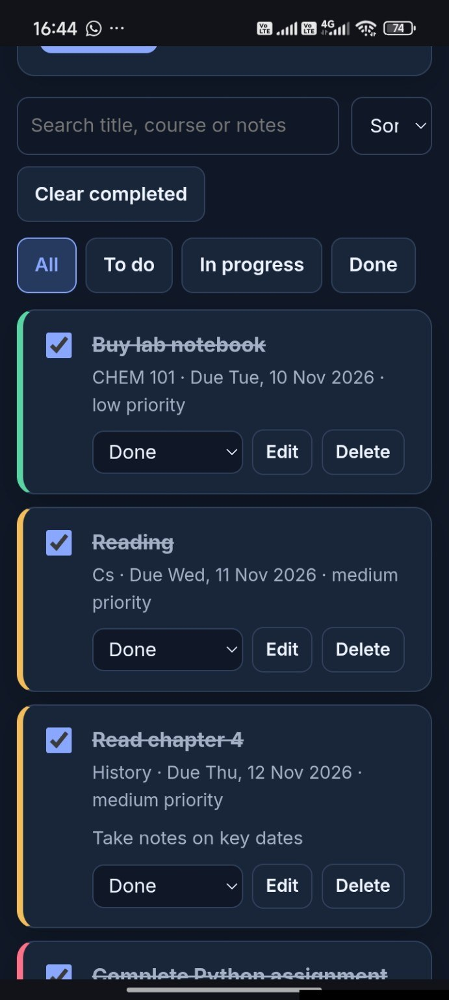

Student Task Manager

A responsive, browser-based application that helps students organize academic tasks, manage assignment deadlines, set priorities and monitor their progress.

Live demo: https://koffimukholi67-sudo.github.io/student-task-manager-app/

## Screenshots

### Dashboard — all tasks completed

### Dashboard — deadline reminders

### Task list and status controls

Overview

Student Task Manager provides a simple dashboard for keeping track of coursework and other academic responsibilities. Add tasks, assign a course and due date, choose a priority, and update each task as work progresses.

The application is built with standard front-end web technologies and stores tasks in the browser using Local Storage.

Features

- Create tasks: Add a title, course or subject, due date, priority and optional notes.
- Edit and delete: Update existing tasks or remove tasks you no longer need.
- Track progress: Set each task to To do, In progress or Done.
- Search and filter: Find tasks and view them by progress status.
- Sort: Organize tasks using the available sorting options.
- Dashboard: See total tasks, completed tasks, overdue tasks and completion percentage.
- Deadline reminders: Get on-screen reminders for overdue tasks and tasks due soon.
- Theme switcher: Choose light or dark appearance.
- Local storage: Keep tasks saved in the same browser on the same device.

Technology Stack

Technology| How it is used
HTML5| Structures the application and its forms
CSS3| Provides layout, responsive styling and themes
JavaScript| Handles task creation, editing, filtering, sorting and dashboard updates
Browser Local Storage| Saves task data locally in the browser

Getting Started

Use the live application

Open the "Student Task Manager live demo" (https://koffimukholi67-sudo.github.io/student-task-manager-app/) in a modern browser. No installation is required.

Run the project locally

1. Clone this repository or download it as a ZIP file.
2. If you downloaded a ZIP file, extract it.
3. Open the project folder.
4. Open "index.html" in a modern web browser.

The application is a self-contained HTML file, so a separate build step or package installation is not required.

How to Use

1. Enter a task title.
2. Optionally enter the course or subject.
3. Choose a due date and priority.
4. Add notes if needed.
5. Select Add task.
6. Update the task status as you work.
7. Use search, filters and sorting to find tasks.

Data Storage and Privacy

Tasks are stored in the browser's Local Storage.

- Your tasks are available in the same browser profile on the same device.
- Tasks are not synchronized automatically between devices or browsers.
- Clearing browser data or site storage may delete saved tasks.
- Do not enter passwords or other sensitive personal information.

Project Structure

student-task-manager-app/
├── screenshots/
│   ├── dashboard-completed.jpg
│   ├── dashboard-deadlines.jpg
│   └── task-list.jpg
└── index.html

What I Learned

This project is part of my Computer Science learning journey. It gave me practical experience with:

- Structuring a web page with HTML.
- Styling responsive interfaces with CSS.
- Writing JavaScript to respond to user actions.
- Manipulating the Document Object Model (DOM).
- Handling forms, events, search and filtering.
- Saving and retrieving data with browser Local Storage.
- Publishing a static website with GitHub Pages.

Possible Future Improvements

- Add optional cloud synchronization and database storage.
- Add downloadable task reports.
- Add calendar integration.
- Improve accessibility and usability through further testing.
- Add automated tests for core task-management features.

Developer

Koffi Mukholi Nyongesa
Computer Science Student
University of Kabianga, Kenya

- GitHub: https://github.com/koffimukholi67-sudo
- Repository: https://github.com/koffimukholi67-sudo/student-task-manager-app
- Live demo: https://koffimukholi67-sudo.github.io/student-task-manager-app/

---

Built as a learning project to strengthen my practical web development and problem-solving skills.
